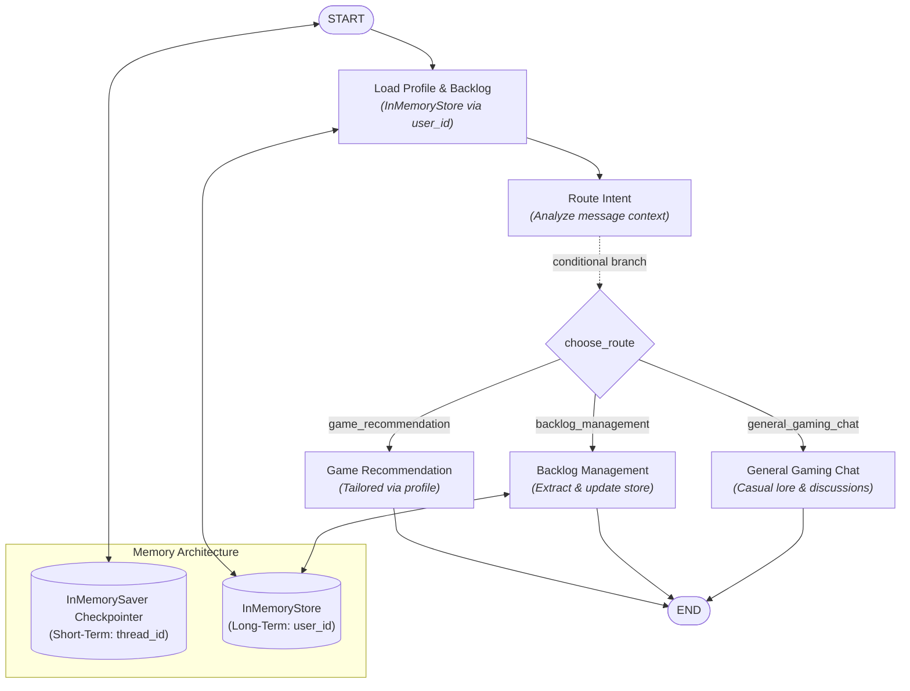

# 🎮 GameMate — Personal AI Gaming Companion

[](https://github.com/langchain-ai/langgraph)
[](https://fastapi.tiangolo.com)
[-orange.svg)](https://ollama.ai)
[](https://www.python.org/)
[](LICENSE)

**GameMate** is an intelligent, local AI-powered gaming companion built with **LangGraph**, **FastAPI**, and **Ollama**. It features conversational short-term memory across chat threads, persistent long-term memory for gaming profiles and backlogs across sessions, dynamic graph intent routing, and an interactive cyberpunk-styled UI with a live memory and execution inspector.

---

## ✨ Key Features

- **🧠 Dual-Layer Memory Architecture**:
  - **Short-Term Conversational Memory**: Managed by LangGraph's `InMemorySaver` checkpointer, persisting message threads per `thread_id`.
  - **Long-Term Profile & Backlog Store**: Managed by LangGraph's `InMemoryStore`, persisting player preferences, favorite genres, platforms, and game backlogs per `user_id` across different threads.
- **🔀 Dynamic Conditional Routing**:
  - StateGraph nodes automatically route queries to specialized sub-nodes:
    - `game_recommendation`: Generates tailored game picks based on profile & recent context.
    - `backlog_management`: Automatically extracts game titles, updates backlog lists, and tracks status.
    - `general_gaming_chat`: Engages in gaming lore, mechanics, troubleshooting, and casual talk.
- **⚡ Dual State Reducers**:
  - `add_messages`: Automatically appends messages and manages turn IDs.
  - `operator.add`: Dynamically accumulates activity logs as execution flows through graph nodes.
- **✂️ Smart Context Trimming**:
  - Employs LangChain's `trim_messages` before invoking Ollama to maintain optimal token efficiency while preserving the full session in the checkpointer.
- **💻 100% Local & Private**:
  - Runs with local models via Ollama (`llama3.2:3b`), ensuring zero API costs and full data privacy.
- **🎨 Cyberpunk Glassmorphism UI**:
  - Responsive web interface featuring:
    - Real-time conversation view with Markdown support
    - Live Memory & Graph Execution Inspector
    - Interactive Backlog sidebar
    - Thread switcher (`thread-1`, `thread-2`, etc.)
    - Pre-built quick action prompt pills

---

## 🏗️ LangGraph Workflow Architecture



---

## 🚀 Getting Started

### Prerequisites

1. **Python 3.10+** installed.
2. **Ollama** installed and running:
   ```bash
   # Download Ollama from https://ollama.ai
   # Pull the lightweight Llama 3.2 model
   ollama pull llama3.2:3b
   ```

### Installation

1. **Clone the repository**:
   ```bash
   git clone https://github.com/kashish731/GameMate.git
   cd GameMate
   ```

2. **Create and activate a virtual environment**:
   ```bash
   # Windows (PowerShell)
   python -m venv .venv
   .\.venv\Scripts\Activate.ps1

   # Linux / macOS
   python3 -m venv .venv
   source .venv/bin/activate
   ```

3. **Install dependencies**:
   ```bash
   pip install -r requirements.txt
   ```

---

## 🏃 Running the Application

1. Make sure your Ollama instance is running:
   ```bash
   ollama serve
   ```

2. Launch the FastAPI server:
   ```bash
   uvicorn app:app --reload --host 127.0.0.1 --port 8000
   ```

3. Open your browser and navigate to:
   ```
   http://localhost:8000
   ```

---

## 🔌 API Reference

### `GET /`
Serves the single-page web application (`index.html`).

### `POST /chat`
Executes a conversation turn through the LangGraph StateGraph.

**Request Body:**
```json
{
  "message": "I love Soulslike games and play on PC. What should I play next?",
  "thread_id": "thread-1",
  "user_id": "player-1"
}
```

**Response Body:**
```json
{
  "response": "Since you love Soulslike games on PC, you definitely need to check out Lies of P or Elden Ring's Shadow of the Erdtree DLC! Both offer immaculate parry mechanics and atmospheric level design.",
  "route": "game_recommendation",
  "activity_log": [
    "Short-term memory loaded for thread: thread-1",
    "Long-term profile loaded for user: player-1",
    "Profile updated: favorite_genres += Soulslike",
    "Profile updated: platforms += PC",
    "Route selected: game_recommendation",
    "Messages trimmed: 1 -> 1",
    "Recommendation generated by Ollama"
  ],
  "trim_stats": {
    "before": 1,
    "after": 1
  },
  "thread_id": "thread-1",
  "user_id": "player-1",
  "profile": {
    "favorite_genres": ["Soulslike"],
    "platforms": ["PC"],
    "preferences": []
  },
  "backlog": [],
  "short_term_memory": [
    {
      "role": "user",
      "content": "I love Soulslike games and play on PC. What should I play next?"
    },
    {
      "role": "assistant",
      "content": "..."
    }
  ]
}
```

### `GET /profile?user_id=player-1`
Retrieves the persistent long-term profile and backlog for a specific `user_id`.

---

## 📂 Project Structure

```
GameMate/
│
├── app.py              # FastAPI server, LangGraph StateGraph definition, nodes & routing
├── index.html          # Cyberpunk glassmorphic UI, Live Inspector & Backlog drawer
├── requirements.txt    # Python dependencies
├── .gitignore          # Git exclusion rules
└── README.md           # Project documentation and guide
```

---

## 🛠️ Technology Stack

- **Framework**: [FastAPI](https://fastapi.tiangolo.com)
- **Agent Orchestration**: [LangGraph](https://github.com/langchain-ai/langgraph)
- **Memory Checkpoints**: `InMemorySaver` & `InMemoryStore`
- **LLM Integration**: [LangChain Ollama](https://github.com/langchain-ai/langchain) (`llama3.2:3b`)
- **Frontend**: Vanilla HTML5, CSS3 Glassmorphism, Modern Vanilla JavaScript

---

## 📄 License

This project is licensed under the [MIT License](LICENSE).
